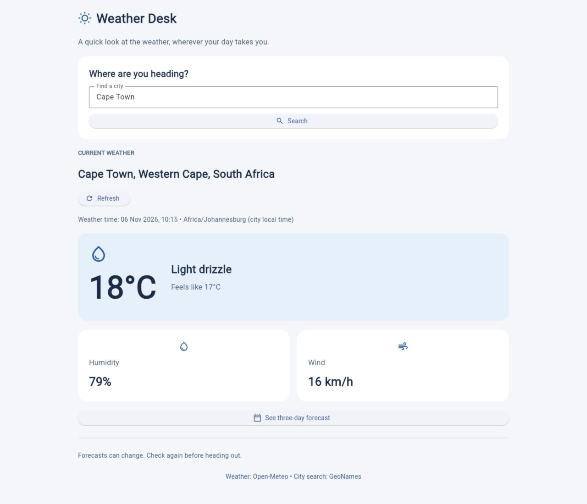

# Weather Desk

My FNB App Academy Phase 3 capstone: a small weather dashboard built with Python and Flet.

I wanted a quick way to check the weather before travelling or spending time outside. The app is aimed at someone who wants a clear forecast without a busy screen. I still need to test that idea with other people.

## What it does

- Searches for cities and lets you choose the right location from the results.
- Shows current temperature, conditions, feels-like temperature, humidity and wind.
- Opens a separate three-day forecast view and refreshes the selected city's data.

Johannesburg loads first. Temperatures use Celsius and wind uses km/h. Times are shown in the selected city's timezone. Forecast dates come from the API, so they follow that city's calendar too.



[View the forecast screen](screenshots/forecast.jpg).

## Run it

Use Python 3.12 or newer. From this folder:

```sh
python3 -m venv .venv
source .venv/bin/activate
python -m pip install -r requirements.txt
python main.py
```

On Windows, activate with `.venv\Scripts\activate` instead. To run in a browser:

```sh
flet run --web main.py
```

An internet connection is needed. No API key is required.

## How I organised it

`main.py` handles the two screens, city selection and button actions. `weather.py` holds the city and weather classes, API requests and response parsing. Requests run in a background thread so the screen can stay responsive.

The app requests only the readings it needs. There are no videos, large images or automatic refreshes. Labels use plain language, cards stack on small screens, and dark text sits on light backgrounds. A failed refresh keeps the previous readings with a visible warning; the app never replaces missing readings with made-up values.

I practised classes, JSON, error handling, async event handlers and routing in this project. One useful distinction was keeping the API code separate from the screen code so I could test failures without changing the interface.

## Check it

```sh
python -m unittest discover -s tests -v
```

The tests cover response parsing, missing readings, connection failures, HTTP errors and city search results. For a manual check: search for Cape Town, choose the South African result, open the forecast, go back and refresh. Also try an empty search and a city name that does not exist. With your connection disconnected, Refresh should show an error and keep any previous readings.

I checked city selection, refresh, navigation, empty and unknown searches, and the layout at phone width. A simulated connection failure also kept the previous weather and showed a warning. All nine automated tests pass.

## Data

Weather forecasts: [Open-Meteo](https://open-meteo.com/) ([forecast API](https://open-meteo.com/en/docs)). City lookup: [Open-Meteo geocoding](https://open-meteo.com/en/docs/geocoding-api), using GeoNames data. Data is provided under [CC BY 4.0](https://creativecommons.org/licenses/by/4.0/). This learning project uses the free API for non-commercial use. Weather is modelled forecast data and can change.
